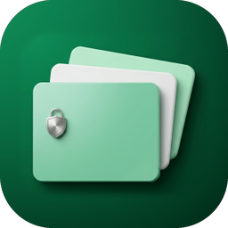
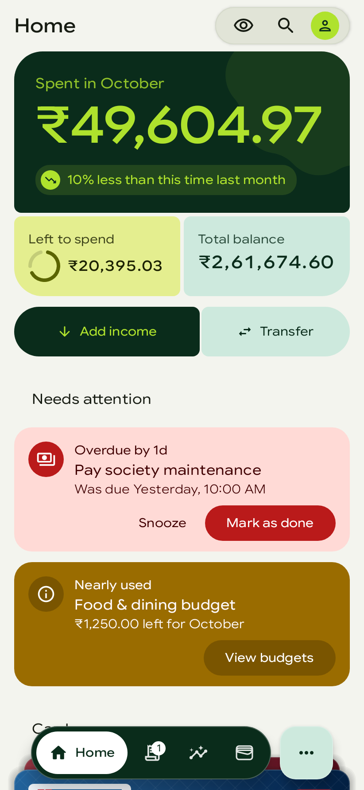
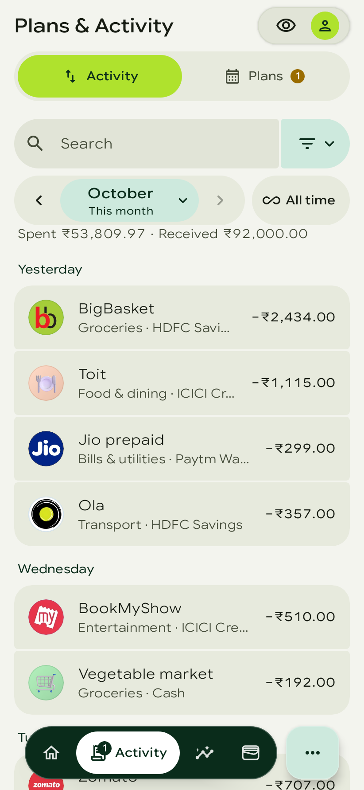
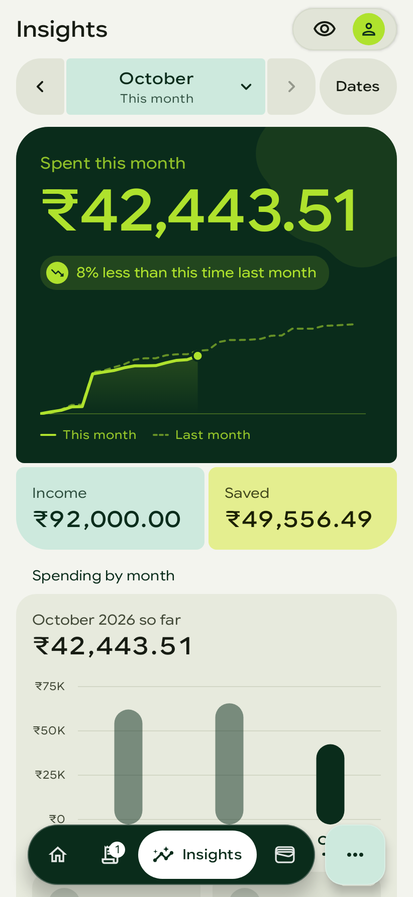
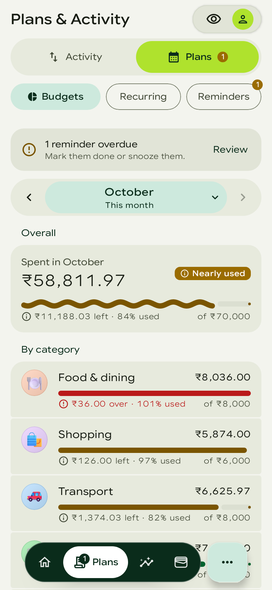
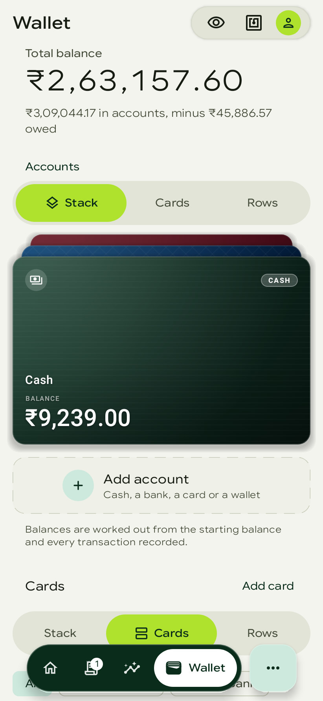
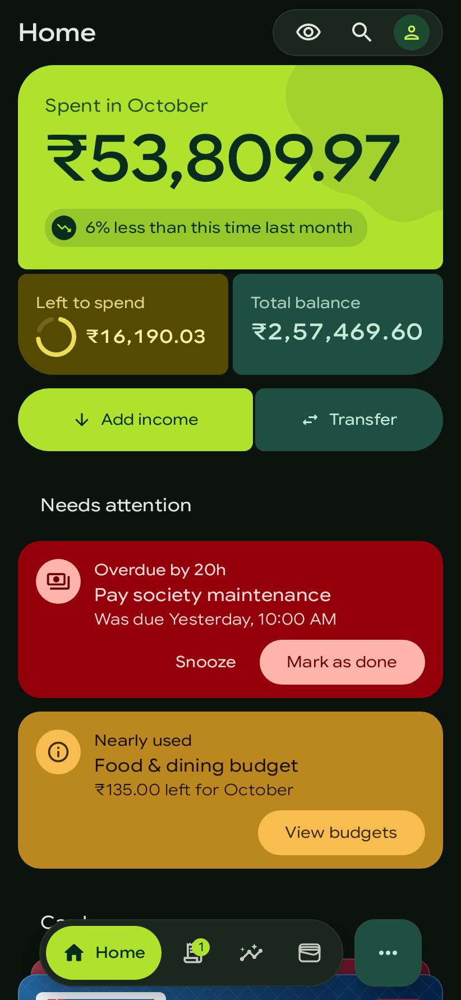
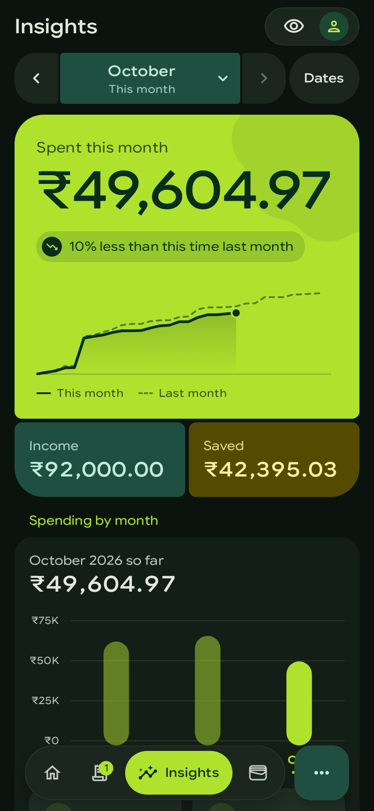
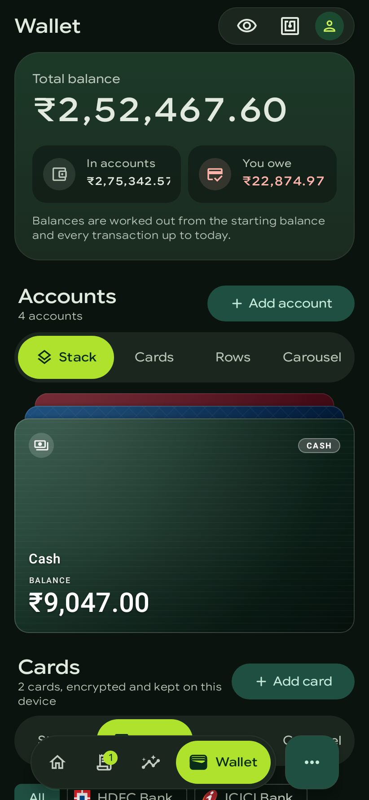
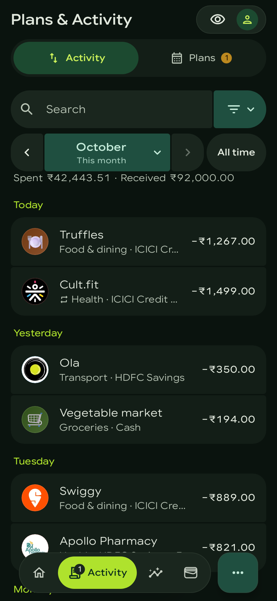

<p align="center">
  
</p>

<h1 align="center">NormPix</h1>

<p align="center">
  Your money, cards and reminders in one private Android app.<br>
  Offline-first: everything stays on your phone.
</p>

<p align="center">
  
  
  
  
</p>

<p align="center">
  <a href="../../releases/latest"><b>Download APK</b></a> &nbsp;|&nbsp;
  <a href="#install">Install</a> &nbsp;|&nbsp;
  <a href="#faq">FAQ</a> &nbsp;|&nbsp;
  <a href="#build">Build</a> &nbsp;|&nbsp;
  <a href="../../issues">Issues</a>
</p>

---

## About

NormPix is a personal finance tracker and card wallet for Android, built natively with **Kotlin**, **Jetpack Compose** and **Material 3 Expressive**. You record spending and income by hand, or by sharing a payment app's receipt with it. It keeps budgets, repeating payments and reminders, shows where the money went, and holds your cards in an encrypted vault. There is no account, no server and no tracking: the one connection the app makes is to GitHub, to check for its own updates.

## Screenshots

<p align="center">
  
  
  
</p>
<p align="center">
  
  
  
</p>
<p align="center">
  
  
  
</p>
<p align="center">
  <sub>Home · Activity · Insights · Budgets · Wallet, light and dark. Every screenshot shows the app's built-in sample data
  (Settings → Data &amp; backup → Sample data); no real person's money is in them.</sub>
</p>

## Highlights

- **Private by design.** Your data lives in on-device SQLite databases; cards sit in an AES-256-GCM vault. There's no account and no analytics, and the network security config refuses every host but GitHub.
- **Add a transaction in seconds.** Share a receipt or payment screenshot from Google Pay, PhonePe or your bank app, and NormPix reads it on the device (ML Kit) and fills in the amount, payee, account and category for you to check.
- **Plans that keep up.** Monthly budgets per category, repeating payments that record themselves, and reminders with snooze, all on the Plans & Activity tab.
- **Insights that answer questions.** Where the money went, what changed from last month, spending per person, and any range of days you pick.
- **A wallet you can trust.** Card numbers are encrypted, hidden until you unlock (fingerprint, face or screen lock, or a tap on your own NFC tag), and cleared from the clipboard after copying. Screenshots of the app are blocked.
- **On your home screen.** Three widgets: your recent transactions at a glance, one tap to add an expense, income or a transfer, and a clock with turning rings after a watch face. They follow your wallpaper's colours on Android 12 and later, and show nothing of your ledger while NormPix is locked.
- **Made to feel native.** Material 3 Expressive throughout, your choice of accent and font (or a Pure black-and-white theme), ten app icons, and six page-transition styles, including a Linux-like window open and close.
- **A guide inside the app.** Settings → About NormPix explains how each feature works, step by step, with pictures drawn in your own theme.

<details>
<summary><b>All features</b></summary>

**Money**
- Accounts: cash, bank, card, wallet and savings, with bank logos, credit limits, statement and due days
- Categories with sub-categories, shown as 3D pictures, emoji or outline icons, with brand logos; a full ready-made set to start from
- Transactions with a payee, note, person and an attached picture (bill, receipt, screenshot), which can be read again to fill the form
- Transfers between accounts, including paying a credit card's bill
- Monthly budgets per category, with history
- Repeating payments, recorded on their day
- People: label expenses with who they were for, and see the totals per person
- Search and filters by type, account, category, person, amount and dates
- Insights: the month's snapshot, trend, top categories, what changed, and custom date ranges
- Swipe actions on every list, undo after deleting

**Wallet**
- Cards stored encrypted, with bank designs and the card's network
- Scan a card's number with the camera, on the device
- Reveal and copy details only after unlocking; the clipboard is cleared after a set time
- Card expiry reminders
- Send a card to another phone running NormPix over NFC: off until you turn it on in Settings → Availability & Schedules, then always or on a schedule you choose

**Reminders**
- One-off or repeating, with exact alarms, snooze and complete from the notification
- Linked to what they're about: a transaction, a repeating payment, an account or a card's bill

**Your data**
- Full backup with pictures (.zip), a small backup without them (.json), and a spreadsheet export (.csv)
- Restore checks the file first and asks before replacing anything
- Sample data to try everything without entering your own

**Look and feel**
- Light, dark or the system's theme; wallpaper colours or a chosen accent, each shown as a preview of the colours it gives the app; a Pure black-and-white theme
- Interface fonts, icon shapes and backgrounds, the frosted blur behind sheets
- Six page-transition styles, ten launcher icons, and an animated splash screen

**Updates**
- Checks GitHub once a day (or when you ask) and installs only an update signed with the same key
- Downloads carry on with the app closed, with progress in a notification, then install with one tap

</details>

<details>
<summary><b>Recent improvements</b></summary>

- A dedicated update page; download progress in a notification, with Download and Install buttons there too
- A date range sheet in the month picker's style, with ready-made ranges
- An animated splash screen that writes out the app's name
- Linux window transitions you can actually see
- Categories added in an update now reach phones that already had the app
- The Plans & Transactions tab is now Plans & Activity

</details>

## Install

1. Download the latest `.apk` from [Releases](../../releases/latest): `NormPix-<version>-arm64-v8a.apk` for almost every phone made since 2017 (the smallest download), `NormPix-<version>-armeabi-v7a.apk` for an older 32-bit phone, or `NormPix-<version>.apk` that works on both and is the largest.
2. Open it on your phone. If Android asks, allow your browser or files app to install unknown apps.
3. That's it: NormPix checks for updates by itself (Settings → Updates & changelog → Automatic updates), and installs them over the app you have, keeping your data.

> [!NOTE]
> Only release builds update themselves. Debug and qa builds are signed with another key, so a release can't install over them; uninstall one first.

## FAQ

### Does NormPix send my data anywhere?
> No. Your transactions, cards and reminders never leave the phone. The only connection is to GitHub, to check for and download NormPix's own updates. Android's network security config refuses every other host, and ML Kit's telemetry upload is taken out.

### Can I try it without entering my own data?
> Yes. Turn on **Settings → Data & backup → Sample data**: about three months of accounts, transactions, budgets, repeating payments, reminders and cards appear. It lives in memory only, so turning it off brings your own data back, untouched.

### How do I move to a new phone?
> Make a **Full backup, with pictures** (Settings → Data & backup), copy the `.zip` to the new phone, install NormPix there and **Restore from backup**. Card numbers are never put in a backup; add your cards again on the new phone.

### Does it read my SMS or notifications?
> No. NormPix has no SMS or notification-listener permission. To add a transaction from a payment app, share its receipt or screenshot with NormPix.

### Why does the update notification stay while downloading?
> A download you start runs in a foreground service, so it keeps going after you close the app. Android needs that service to show a notification; it goes away when the download finishes or you tap **Cancel**.

## Project structure

```plaintext
native/                         The Android app (Kotlin, Jetpack Compose)
├── app/src/main/kotlin/com/example/normpix/
│   ├── finance/                Money: data (SQLite, backups), domain (ledger, budgets), share (receipt reading), ui
│   ├── wallet/                 Cards: encrypted vault, card faces, NFC, expiry reminders, secure clipboard
│   ├── reminders/              Reminders: model, alarms, notifications, screens
│   ├── screens/                Home, Plans & Activity, Wallet tabs
│   ├── navigation/             App shell, navigation bar, page transitions, splash, search
│   ├── settings/               Preferences and the Settings pages
│   ├── updates/                In-app updates from GitHub releases
│   ├── ui/                     Design system: theme, tokens, sheets, lists, components
│   └── banks/, availability/   Bank directory, scheduled features
├── app/src/test/               Unit and Robolectric UI tests (and the README's screenshots)
└── design/app-icon/            Where the launcher icons come from
docs/                           README pictures (docs/screenshots is generated)
lib/                            The earlier Flutter app, kept for reference
.github/workflows/              CI: tests, lint, releases, screenshots
```

## Screenshots in this README

The pictures in [`docs/screenshots`](docs/screenshots) are rendered by Robolectric from the app's real screens with the sample data ([`ReadmeScreenshots.kt`](native/app/src/test/kotlin/com/example/normpix/ReadmeScreenshots.kt)), so they stay true to the app:

- [`.github/workflows/screenshots.yml`](.github/workflows/screenshots.yml) renders them again whenever the app changes on `main`, and commits them when they changed. For a pull request it pushes them to the branch `readme-screenshots/<branch>` to look at.
- To render them on your own machine:

  ```bash
  cd native
  ./gradlew testDebugUnitTest --rerun --tests 'com.example.normpix.ReadmeScreenshots' -Pscreenshots="$PWD/../docs/screenshots"
  ```

## Build

The Android project is located in the [`native/`](native/) directory:

```bash
cd native

# Run all unit and Robolectric Compose UI tests
./gradlew testDebugUnitTest

# Run Android Lint
./gradlew lintDebug

# Build release APK (R8 minified and resource-shrunk)
./gradlew assembleRelease

# Build it as CI does: one APK per phone CPU type (arm64-v8a, armeabi-v7a) and a universal one holding both
./gradlew assembleRelease -PsplitAbis
```

## CI/CD and releases

[`.github/workflows/android.yml`](.github/workflows/android.yml) runs on GitHub Actions:

- **Pull requests into `main`**: unit and Robolectric UI tests, Android Lint, and a release build. The APK is attached to the run as the `apk` artifact.
- **Every push to `main`** (or a manual run on `main` from the Actions tab): the same checks, then a **release** the app updates to, at the next free version: `versionName`, or the patch after the highest `vX.Y.Z` tag of its `X.Y` if that is as high (with `versionName` 1.0.2 and `v1.0.8` tagged, the next is `v1.0.9`). Raise `versionName` (to `1.1.0`, say) to start a new line. To publish `main`'s builds as test builds instead (**prereleases**, tagged `v<versionName>-build.<run number>`, which the app never offers as an update), set `MAIN_BUILDS: prerelease` at the top of the workflow.
- **A version tag** (`v1.1.0`, matching `versionName`): the same checks, then that version as a **release** (see below).

### Releases and in-app updates

The app checks GitHub for a newer release once a day, in the background and at launch (Settings → Updates & changelog → Automatic updates, on by default; turn it off and the app only checks when asked), or when asked: Settings → Updates & changelog (or Check now under Automatic updates) opens the update page, which asks GitHub and shows where updating stands. Under the status the page holds the **changelog**: what every published version changed, newest first, as a short list of changes per version, with the installed version open and a newer one marked "New". It is read from the releases' own notes (the commit subjects CI writes, or a tag's message), kept on the phone so it reads offline, and also shown for a build that doesn't update itself. What happens to an update found in the background is the user's choice there: **Tell me** (a notification), **Download it, then ask** (the default: downloaded in the background, then a notification says it's ready to install), or **Install it automatically** (downloaded and installed without asking once the app has been closed for a while, on Android 12 and later; a notification says what was installed, and if Android wants a confirmation it waits for the user's Install instead). Background downloads wait for Wi-Fi unless **Download on mobile data** is on. The daily run is a JobScheduler job (`UpdateJobService`), kept over a restart, and not run while the battery is low.

In the app, **Update now** downloads the APK and checks its size, SHA-256, package name, version and signing key; the page (or sheet) then says it's ready, and only **Install** hands it to Android's installer, which asks the user to confirm. While it downloads, a notification shows how far it is, with **Cancel**; a download the user started runs in a foreground service (`UpdateDownloadService`, `FOREGROUND_SERVICE_DATA_SYNC`), so it carries on with the app closed, and once it's done the notification says it's ready to install, with **Install**. An "Update available" notification has **Download**, which downloads it the same way without opening the app. Every download, in the app or in the background, gets the same checks, and the app is never uninstalled. Only release builds update themselves: debug and qa builds carry another key, so no release could install over them.

Every push to `main` publishes one on its own. To publish a version of your choosing, with notes of your own:

1. Raise `versionName` in [`native/app/build.gradle.kts`](native/app/build.gradle.kts). `versionCode` is made from it (`1.0.3` → `10003`), so a newer version always has the higher code; the app compares releases by that number.
2. Commit, then tag that commit `v<versionName>` and push the tag:

   ```bash
   git tag -a v1.0.3 -m "What changed in this release"
   git push origin v1.0.3
   ```

CI fails a tag that doesn't match `versionName`, a release that isn't signed with the release key, and a `versionCode` that isn't above the latest release's. It publishes the APKs (one per phone CPU type, which the app picks from by itself, and a universal one for an app too old to choose), their checksums and **`update.json`**, the release's description the app reads (version, APK name, size, SHA-256 - for the universal APK and for each CPU type under `apks` - minimum Android version, notes), and marks the release latest. The notes are the annotated tag's message, or else the commits since the previous release. A line `mandatory: true` in the tag's message makes the app offer the release at every launch, even after Later; it is still never forced.

**Where the app looks.** The app asks GitHub without signing in and carries no token, so the releases it reads have to be **public**. It looks in the repository it was built for: `NORMPIX_UPDATE_REPOSITORY` (Gradle property `normpixUpdateRepository`), which CI sets from the `UPDATE_REPOSITORY` repository variable and otherwise to this repository. While this repository is private, either:

- make it public, or
- create a public repository for releases only (with at least one commit, e.g. a README), set the repository variable `UPDATE_REPOSITORY` to it (`owner/name`), and add a secret `RELEASES_TOKEN`: a fine-grained token with **Contents: read and write** on that repository only. CI then publishes releases (and prereleases) there, and the app built by that run looks there.

### Signing key

Android installs an update only if it is signed with the same key as the app already on the phone. Every release is signed with one fixed key, the **release key**: the key the installed NormPix has always carried (certificate SHA-256 `96:B3:0A:AE:…:5A:34:88`; its alias and passwords are kept with the keystore, not here). CI reads it from these repository secrets (Settings → Secrets and variables → Actions):

| Secret | Value |
|---|---|
| `RELEASE_KEYSTORE_BASE64` | The keystore file, base64-encoded: `base64 -w0 release.jks` (macOS: `base64 -i release.jks`) |
| `RELEASE_KEYSTORE_PASSWORD` | The keystore password |
| `RELEASE_KEY_ALIAS` | The key's alias |
| `RELEASE_KEY_PASSWORD` | The key's password |

The release job checks the APK's certificate against the release key's fingerprint (`RELEASE_CERT_SHA256` in the workflow) and publishes nothing signed with any other key. Without the secrets a prerelease is still published, signed with the debug key (it won't install over the app), and a release fails.

A release built on your own machine is signed with the same key when Gradle knows where it is, from `~/.gradle/gradle.properties`:

```properties
normpixKeystoreFile=C:/Users/<you>/.android/normpix-release.jks
normpixKeystorePassword=<keystore password>
normpixKeyAlias=<key alias>
normpixKeyPassword=<key password>
```

(or the environment variables `NORMPIX_KEYSTORE_FILE`, `NORMPIX_KEYSTORE_PASSWORD`, `NORMPIX_KEY_ALIAS`, `NORMPIX_KEY_PASSWORD`, which CI uses). Keep a backup of that keystore: without it no later APK can update the app.

**Debug and qa builds** are signed with a key of their own, `native/app/debug.keystore` (in the repository; alias `androiddebugkey`, passwords `android`), so every machine signs them alike and they can never install over the real app. A debug build installed before this key existed has to be uninstalled once.


## License

This repository doesn't include a license yet. Until one is added, the author keeps all rights to the code, and you may not copy or redistribute it.

---

<div align="left">
<sub>NormPix is a personal project and isn't affiliated with any bank, card network or payment app. Bank and brand names and logos belong to their owners and are shown only to label your own accounts and payments. GS Flex is Google Sans Flex under the SIL Open Font License 1.1; 3D category pictures are Microsoft Fluent Emoji (MIT).</sub>
</div>
